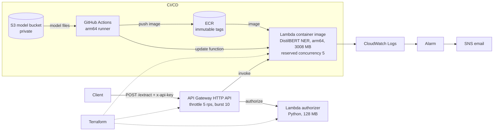

# Serverless NER API on AWS


A fine-tuned DistilBERT named-entity-recognition model (people, organizations, locations, miscellaneous) served as a serverless HTTP API on AWS: a Lambda container image behind API Gateway, with a Lambda authorizer, throttling and a concurrency cap. Infrastructure is Terraform; every push to `main` builds, ships and smoke-tests a new image with GitHub Actions.

<!-- DEMO -->

## Architecture



Region: `ap-southeast-2` (Sydney). Lambda and API Gateway are managed regional services that run across multiple Availability Zones by default, so no extra high-availability setup is needed.

## Usage

```bash
curl -X POST "$API_URL" \
  -H "Content-Type: application/json" \
  -H "x-api-key: $API_KEY" \
  -d '{"text": "Angela Merkel met Tony Blair in Berlin."}'
```

```json
{"entities": [
  {"entity": "PER", "text": "Angela Merkel", "score": 0.8665, "start": 0, "end": 13},
  {"entity": "PER", "text": "Tony Blair", "score": 0.9984, "start": 18, "end": 28},
  {"entity": "LOC", "text": "Berlin", "score": 0.9965, "start": 32, "end": 38}
]}
```

Responses: 200 success, 400 bad input (text must be 1 to 2,000 characters), 401 missing key, 403 wrong key, 429 over the rate limit, 503 when the concurrency cap is reached.

## Model

DistilBERT (cased) fine-tuned for token classification on CoNLL-2003: 3 epochs, learning rate 2e-5, batch size 32, one Colab T4 GPU. Entity-level F1 (seqeval): **0.889 on the test set** (precision 0.880, recall 0.897) and 0.929 on validation. Training script: `training/train_ner.py`, consistent with the saved training arguments (seed 42, linear schedule, no warmup, AdamW); the model was trained with transformers 5.22.1. Model weights and training data are not in this repository.

## Measured results (11 Nov 2026)

| What | Result | How measured |
|---|---|---|
| Warm Lambda duration | p50 59 ms, p95 73 ms, p99 76 ms (577 invocations) | CloudWatch REPORT lines |
| End to end, Nagpur (India) to Sydney | p50 0.40 s, p95 0.49 s, p99 1.41 s (150 requests, 3 connections, all HTTP 200) | `hey` |
| Cold start | init 5 to 8 s (7.4 to 7.7 s when several start in parallel); about 8 s for the first request | Lambda INIT and REPORT lines |
| Worst case seen | first request after a deploy, or an unlucky parallel cold start: init passed Lambda's 10 s init limit and was redone inside the invocation, so the request took 16 to 22 s after a 10 s failed attempt, and once hit the 30 s function timeout | CloudWatch (4 occurrences over two days of testing) |
| Memory | 750 MB used of 3008 MB configured | CloudWatch |
| Image size | 724 MB in ECR (limit 10 GB) | ECR |
| Throttle check | at about 7.5 requests/s against a 5 rps limit, 59 of 198 requests got 429 and never reached Lambda | `hey` |
| Pipeline | about 3.5 minutes from push to a verified deploy | GitHub Actions |
| Cost | about $0.003 per 1,000 requests: Lambda about $0.0026 (60 ms at 3008 MB on arm64) plus API Gateway about $0.001; US East list prices, free tier excluded, other regions differ | calculation |

Client-side latency is dominated by network distance to Sydney. Server-side time is the warm Lambda duration.

## Design decisions

| Decision | Why |
|---|---|
| Lambda container image, not a zip | PyTorch plus the model exceed the 250 MB zip limit; images allow 10 GB |
| HTTP API, not REST API | Cheaper and lower latency; API keys and usage plans are REST-only, so a Lambda authorizer checks a header instead |
| arm64 | Lower price per GB-second; built natively on a GitHub arm64 runner |
| Model baked into the image | No S3 download at start-up; model and code are versioned together |
| Stage throttle plus reserved concurrency of 5 | Caps cost and abuse; verified with load tests |
| Immutable ECR tags (commit SHA, run number, attempt) | Reproducible deploys; rollback means pointing the function at an older tag |
| Terraform owns infrastructure, CI owns the image | `ignore_changes = [image_uri]` avoids drift; `terraform plan` stays clean |
| Model stored in a private S3 bucket for CI | GitHub rejects files over 100 MB |
| Warm-up and smoke test with retries in the pipeline | The first call after a deploy often exceeds Lambda's 10 s init limit and is redone inside the invocation (16 to 30 s), so it is exercised before real traffic |

## Security

- Lambda authorizer compares a shared secret in constant time; results are cached for 300 s.
- The deploy IAM user can only push to one ECR repository, update one function and read one S3 prefix.
- Secrets live in GitHub secrets and Terraform variables; Terraform state is local and git-ignored (it contains the secret).
- The model bucket blocks public access and has versioning enabled.
- GitHub OIDC would be preferable to stored access keys, but an organization-level policy in the account used here denies creating an OIDC provider.

## Known limitations

- **Cold starts** are normally 5 to 8 s, but init has little margin against Lambda's 10 s init limit. When it is exceeded (seen 4 times, mostly on the first call after a deploy), Lambda redoes init inside the invocation and the request takes 16 to 30 s, long enough to fail behind API Gateway's 30 s limit. The pipeline warms each new image with retries; a production setup would use provisioned concurrency or a smaller, faster-loading model.
- **Latency from India** is mostly the network trip to Sydney; Mumbai (`ap-south-1`) would be closer.
- **Model coverage:** CoNLL-2003 is 1990s English news, so modern names can be mislabelled (for example, "Sundar Pichai" is tagged as an organization). English only.
- The shared secret sits in a Lambda environment variable; Secrets Manager with rotation would be better.
- A basic ECR scan reported 16 findings (10 high, 6 medium) from 8 distinct CVEs, all in operating-system packages of the AWS-provided Lambda base image (rpm, glibc, curl, libxml2, ca-certificates) and none in the Python dependencies; not yet patched, since fixes arrive with updated base images (a scheduled rebuild would pick them up).
- Dependency versions are pinned in the Dockerfile (torch 2.15.0 CPU, transformers 5.22.2); the model itself was trained with transformers 5.22.1.
- Terraform state is local; a team setup would use an S3 backend with locking.

## Repository layout

```
app.py                  Lambda handler (loads the model once per cold start)
Dockerfile              AWS Lambda Python 3.12 base image, CPU PyTorch, model
terraform/              API Gateway, Lambdas, IAM, alarm, SNS
.github/workflows/      build, push, deploy, smoke test
training/               training script (CoNLL-2003 fine-tuning)
```

## Deploy it yourself

1. Run `training/train_ner.py` on a GPU and upload the `ner-model/` folder to a private S3 bucket.
2. Create an ECR repository `serverless-ml-ner` with immutable tags and push an initial image tagged `v2` (or set `-var image_tag=...`).
3. `cd terraform`, set `TF_VAR_api_secret` and `TF_VAR_alert_email`, then `terraform init && terraform apply`.
4. Add the GitHub secrets `AWS_ACCESS_KEY_ID` and `AWS_SECRET_ACCESS_KEY` and the variable `MODEL_BUCKET`, then push to `main`.

## Future improvements

- Provisioned concurrency, more memory, or a smaller model (ONNX or quantization) to give init more headroom and cut cold starts.
- Secrets Manager with rotation; GitHub OIDC; remote Terraform state.
- Review and patch the image vulnerabilities with a scheduled rebuild.
- Deploy in Mumbai; put CloudFront and WAF in front if the API goes public.

## License

MIT, see `LICENSE`. The license covers this code only. DistilBERT and the Hugging Face libraries are Apache-2.0; the CoNLL-2003 data comes from Reuters news and has its own, more restrictive terms, which is why no weights or data are included.

Built by [Aditya Mendhe](https://github.com/AdityaMendhe7).
